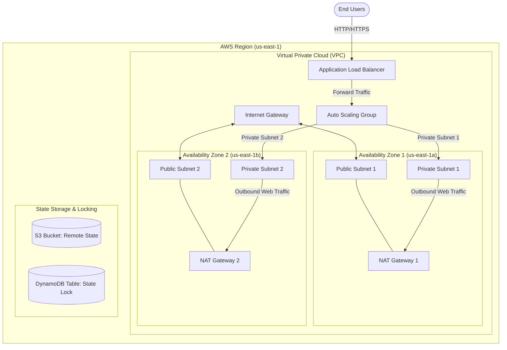

Automated AWS Infrastructure with Terraform & GitHub Actions


Production-ready Infrastructure as Code (IaC) repository that provisions a secure, highly available AWS network and application architecture using Terraform modules, state locking, static security analysis, and automated CI/CD deployment via GitHub Actions.
---
📐 Architecture Overview
This project provisions a multi-AZ Amazon VPC with public and private subnets, an Application Load Balancer (ALB), and Auto Scaling instances managed securely in private subnets.

---
📁 Repository Structure
```text
.
├── .github/
│   └── workflows/
│       ├── terraform-ci.yml       # Lint, format check, and tfsec security scan
│       └── terraform-cd.yml       # Automated deployment on main branch push
├── modules/                       # Reusable infrastructure modules
│   ├── vpc/                       # Multi-AZ VPC, subnets, route tables, IGW & NAT
│   ├── alb/                       # ALB, listener rules, target groups, SG
│   └── compute/                   # EC2 Auto Scaling Group & Launch Templates
├── environments/
│   ├── dev/                       # Development environment configuration
│   │   ├── main.tf
│   │   ├── variables.tf
│   │   ├── outputs.tf
│   │   ├── terraform.tfvars.example
│   │   └── backend.tf
│   └── prod/                      # Production environment configuration
├── .gitignore
├── .tflint.hcl
└── README.md
```
---
🛠️ Prerequisites
Before executing this project, ensure you have configured:
Terraform CLI: `>= 1.5.0` (Download)
AWS CLI: `v2.x` (Download)
AWS IAM Credentials: Configured locally with `aws configure` having adequate permissions.
S3 Bucket & DynamoDB Table: For Terraform remote backend state management and locking.
TFLint & tfsec: Recommended for local static code analysis.
---
🚀 Quick Start Guide
1. Clone the Repository
```bash
git clone https://github.com/your-username/aws-terraform-automation.git
cd aws-terraform-automation/environments/dev
```
2. Configure Backend State
Copy and update `backend.tf` with your S3 state bucket and DynamoDB table name:
```hcl
terraform {
  backend "s3" {
    bucket         = "your-terraform-state-bucket-name"
    key            = "dev/terraform.tfstate"
    region         = "us-east-1"
    dynamodb_table = "terraform-state-locks"
    encrypt        = true
  }
}
```
3. Initialize Variables
Create your variable definitions file from the provided example:
```bash
cp terraform.tfvars.example terraform.tfvars
# Update terraform.tfvars with custom subnet ranges, tags, and key pairs
```
4. Deploy Infrastructure Locally
```bash
# Initialize working directory and modules
terraform init

# Validate formatting and configuration syntax
terraform fmt -check
terraform validate

# Review execution plan
terraform plan -out=tfplan

# Apply configuration
terraform apply tfplan
```
---
🤖 CI/CD Pipeline Integration
This repository implements a multi-stage GitHub Actions pipeline:
Pull Request Workflow (`terraform-ci.yml`):
Executes `terraform fmt -check` and `terraform validate`.
Runs `tfsec` to detect potential security vulnerabilities and misconfigurations.
Generates a non-destructive `terraform plan` output attached as a PR comment.
Main Branch Workflow (`terraform-cd.yml`):
Authenticates to AWS securely via OpenID Connect (OIDC) (no static IAM keys stored in GitHub Secrets).
Executes `terraform apply -auto-approve` upon merging into `main`.
---
🔐 Security & Best Practices Implemented
Least Privilege Network Access: Compute instances reside strictly in private subnets with egress access via NAT Gateways.
State File Protection: Remote state is stored in Amazon S3 with AES-256 encryption, versioning, and state locking enabled via DynamoDB.
Credential Security: Uses AWS IAM OIDC roles for short-lived credentials within automated pipelines.
Automated Security Scanning: Code is continuously scanned using `tfsec` to prevent accidental public exposures or unencrypted resources.
---
🧹 Cleanup / Teardown
To destroy all created AWS resources and prevent unintended cloud charges:
```bash
cd environments/dev
terraform destroy -auto-approve
```
---
📜 License
Distributed under the MIT License. See `LICENSE` for more information.